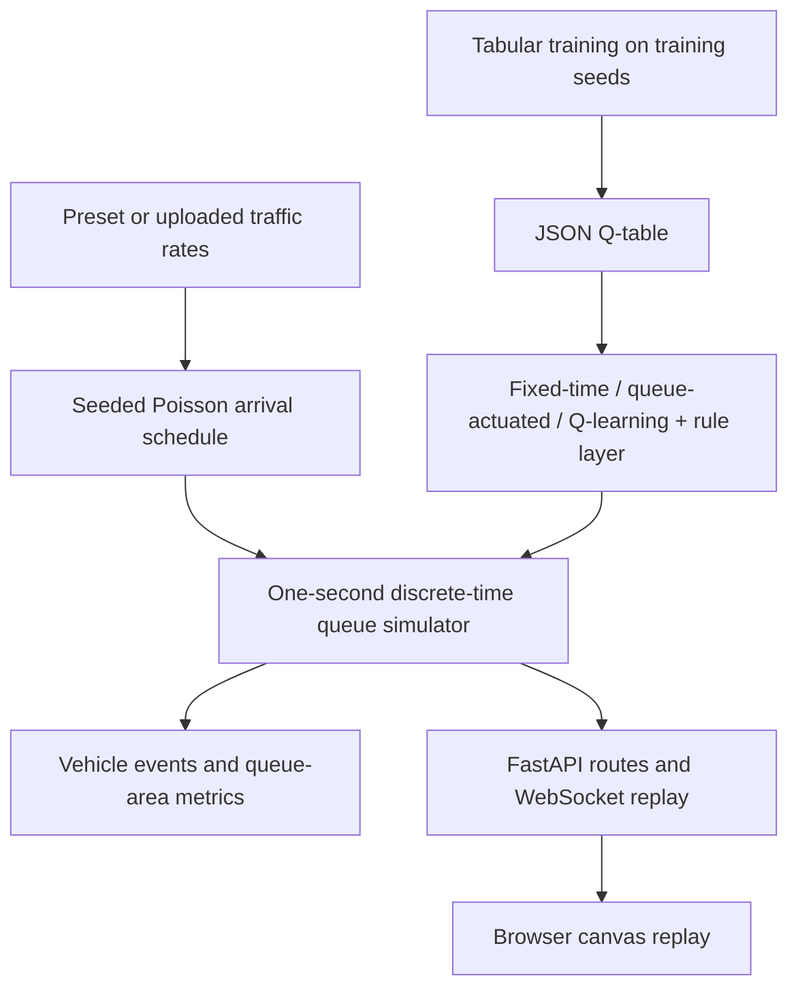

# TrafficLearner

[](https://www.python.org/)
[](https://fastapi.tiangolo.com/)

TrafficLearner is an intersection traffic signal simulator that compares fixed-time, queue-actuated, and tabular Q-learning controllers on shared seeded Poisson arrival schedules. The Q-learning controller is a hybrid: a tabular policy filtered through a hand-written rule layer that enforces safety constraints and prevents wasteful switches. A command-line evaluator runs paired-seed comparisons, and a browser interface streams matched controller executions for visual inspection.

## Architecture



## Features

- Compares fixed-time, queue-actuated, and hybrid Q-learning controllers on identical seeded arrivals.
- Supports 4-way intersections and a 3-way T-junction preset (simulated by suppressing the West approach on a 4-way layout; the state encoding and two-phase signal structure are the same).
- Discretized tabular Q-learning agent with discounted horizon initialization and switch-penalty awareness.
- Hand-written rule layer (`SophisticatedRuleLayer`) that wraps the Q-learning policy, preventing switches on empty queues, enforcing starvation limits, and capping green durations.
- Reports experienced wait, completed wait, average queue length, throughput, and signal switches, with paired standard deviations and 95% confidence intervals.
- Ablation mode evaluates the Q-table alone and the rule layer alone alongside the full hybrid and baselines.
- Streams vehicle and signal events to a browser interface via WebSocket.
- Accepts preset traffic profiles or uploaded CSV, ODS (CN+ Bremen), and SUMO XML rate schedules. Direction mapping from external formats uses a hardcoded heuristic; unrecognised SUMO routes fall back to North and empty aggregation windows default to 0.03 veh/s.

## Simulator Scope

TrafficLearner uses a custom discrete-time queue-based simulator, not a calibrated microsimulation tool. Each approach has one lane by default, there are no turning movements, no car-following model, and no pedestrians. The signal has two fixed phases (North–South green and East–West green) with configurable minimum/maximum green, yellow, and all-red clearance. Vehicles arrive from a Poisson process and depart at a fixed saturation flow (0.5 veh/s/lane) after a 2-second start-up delay. These simplifications mean the results demonstrate the relative behaviour of the controllers within this simulator, not real-world intersection performance.

## Results

Evaluation across 20 paired seeds (seeds 42–61, 300 seconds per run) using the committed policy. The hybrid Q-learning controller applies the rule layer; Q-learning raw runs the Q-table alone; Rules-only runs the rule layer with a constant switch request.

| Scenario | Controller | Experienced wait (s) | ± SD | Queue length | Departed |
|---|---|---:|---:|---:|---:|
| Balanced | Fixed-time | 10.64 | 1.27 | 2.64 | 71.6 |
| Balanced | Queue-actuated | 12.24 | 1.01 | 3.02 | 70.9 |
| Balanced | Q-learning raw | 11.56 | 2.76 | 2.87 | 70.9 |
| Balanced | Rules-only | 9.55 | 1.03 | 2.36 | 71.7 |
| Balanced | **Q-learning (hybrid)** | **10.26** | 1.64 | 2.56 | 71.1 |
| NS Heavy | Fixed-time | 17.28 | 3.91 | 6.39 | 100.2 |
| NS Heavy | **Queue-actuated** | **9.34** | 0.98 | 3.45 | 106.5 |
| NS Heavy | Q-learning raw | 14.22 | 3.52 | 5.27 | 104.5 |
| NS Heavy | Rules-only | 14.06 | 3.09 | 5.20 | 104.2 |
| NS Heavy | Q-learning (hybrid) | 11.99 | 1.93 | 4.44 | 105.2 |
| T-junction | Fixed-time | 11.88 | 1.77 | 3.25 | 77.7 |
| T-junction | Queue-actuated | 12.39 | 1.10 | 3.38 | 77.8 |
| T-junction | Q-learning raw | 12.65 | 1.78 | 3.44 | 77.7 |
| T-junction | Rules-only | 11.72 | 2.36 | 3.22 | 77.8 |
| T-junction | **Q-learning (hybrid)** | **11.44** | 1.51 | 3.13 | 78.2 |
| Heavy | **Fixed-time** | **20.53** | 3.82 | 12.50 | 163.3 |
| Heavy | Queue-actuated | 20.33 | 3.97 | 12.32 | 162.2 |
| Heavy | Q-learning raw | 27.23 | 5.97 | 16.54 | 151.9 |
| Heavy | Rules-only | 26.07 | 5.30 | 15.90 | 154.3 |
| Heavy | Q-learning (hybrid) | 24.24 | 5.31 | 14.77 | 155.7 |

### Observations

- **Balanced and T-junction**: The hybrid Q-learning controller has the lowest mean wait of the five controllers, but the improvement over fixed-time is not statistically significant at the 0.05 level (Balanced: −0.38 s, 95% CI [−1.15, +0.39], p = 0.31; T-junction: −0.43 s, 95% CI [−1.40, +0.53], p = 0.36). The rules-only controller also performs well on Balanced (9.55 s), suggesting the rule layer contributes most of the gain.
- **NS Heavy (directional skew)**: Queue-actuated control is the clear winner (9.34 s). It reacts directly to the queue imbalance without discretization loss. The hybrid Q-learning controller (11.99 s) improves over fixed-time (17.28 s, p < 0.001) but does not beat queue-actuated (p < 0.001, in the wrong direction).
- **Heavy (saturated)**: All controllers struggle under saturated demand. The hybrid Q-learning controller (24.24 s) performs worse than both baselines (fixed-time 20.53 s, queue-actuated 20.33 s). The raw Q-table without the rule layer is worst (27.23 s).
- **Ablation insight**: The rule layer consistently improves Q-learning (Q-raw vs hybrid), and on Balanced demand the rule layer alone outperforms the hybrid. The Q-table adds value mainly under asymmetric demand (NS Heavy), where the hybrid outperforms both Q-raw and rules-only.

### Spike scenario note

The `spike` profile places a West-approach surge at t = 900 s. The 300-second evaluation ends before the surge begins, so any results at that duration are identical to the Balanced scenario and do not test spike handling. To evaluate spike response, run with `--episode_length 1800` or longer.

### Generalisation caveat

Training and evaluation use the same piecewise demand profiles; only the random seed (and therefore the Poisson arrival realisation) differs. The committed training script (`enhanced_train.py`) defaults to training seeds starting at 1000, disjoint from evaluation seeds 42–61. The automated pipeline (`run_enhanced_experiment.py`) now also defaults to seed 1000.

## Quick Start

### Local web app

```powershell
py -m venv .venv
.\.venv\Scripts\Activate.ps1
python -m pip install --upgrade pip
python -m pip install -r requirements-web.txt
python backend/main.py
```

Open `http://localhost:8000/`.

### Train and evaluate

To train a policy and run evaluation:

```powershell
python enhanced_train.py --agent_type tabular --episodes 60 --episode_length 1800 --scenarios balanced morning_peak evening_peak ns_skew heavy spike t_junction --policy_output models/tabular_policy.json
python evaluation.py --agent models/tabular_policy.json --episode_length 300 --runs 20 --scenarios balanced ns_heavy t_junction heavy --ablation
```

To run the automated experiment pipeline:

```powershell
python run_enhanced_experiment.py --episodes 50 --episode_length 900
```

## Technical Design

### Simulation and measurements

The simulator advances in one-second steps. Scheduled arrivals join the single lane of their approach. Vehicles on green approaches depart at a saturation flow of 0.5 vehicles per second per lane after a two-second start-up delay. Green, yellow (3 s), and all-red (1 s) clearance intervals are maintained by the traffic light controller.

Experienced wait is total accumulated queue-seconds divided by total arrivals. Completed wait averages only vehicles that departed. Average queue length is accumulated queue-seconds divided by elapsed simulation time.

### Controllers and rules

The **fixed-time** baseline cycles signals on a fixed 15-second green timer. The **queue-actuated** controller monitors real-time queues and switches when opposing demand exceeds active demand by a configured threshold (default 3 vehicles). The **Q-learning (hybrid)** controller maps discretised queue bins (5 levels per approach), active phase (4 values), and time-in-phase bin to keep/switch actions, with the rule layer (`SophisticatedRuleLayer`) filtering every decision.

The rule layer prevents switching to an empty phase, vetoes switches when the active queue exceeds the waiting queue beyond a dynamic threshold, and forces a switch when a phase has been starved beyond a configurable limit. The baselines do not use this rule layer.

### Data ingestion

The upload pipeline accepts CSV, ODS (CN+ Bremen format), SUMO route XML, and ZIP archives. Direction mapping from Bremen numbered movements and SUMO route identifiers to North/South/East/West uses a hardcoded heuristic lookup table. Unmatched SUMO routes default to North. Raw vehicle counts are aggregated into 5-minute piecewise rates; windows with zero counts receive a default rate of 0.03 veh/s. This adapter converts external data into the simulator's 4-approach Poisson format but does not validate the mapping against the source intersection geometry.

## Tests

Run the test suite with pytest:

```powershell
python -m pytest tests -v
```

The suite includes 32 tests covering simulation dynamics, signal clearance, T-junction topology, queue actuation, Q-learning updates, rule validation, CSV/ODS/SUMO/ZIP ingestion, and paired evaluation metrics.

## License

MIT License

Copyright (c) [2026] [Schrodi-Ø-Ao]

Permission is hereby granted, free of charge, to any person obtaining a copy
of this software and associated documentation files (the "Software"), to deal
in the Software without restriction, including without limitation the rights
to use, copy, modify, merge, publish, distribute, sublicense, and/or sell
copies of the Software, and to permit persons to whom the Software is
furnished to do so, subject to the following conditions:

The above copyright notice and this permission notice shall be included in all
copies or substantial portions of the Software.

THE SOFTWARE IS PROVIDED "AS IS", WITHOUT WARRANTY OF ANY KIND, EXPRESS OR
IMPLIED, INCLUDING BUT NOT LIMITED TO THE WARRANTIES OF MERCHANTABILITY,
FITNESS FOR A PARTICULAR PURPOSE AND NONINFRINGEMENT. IN NO EVENT SHALL THE
AUTHORS OR COPYRIGHT HOLDERS BE LIABLE FOR ANY CLAIM, DAMAGES OR OTHER
LIABILITY, WHETHER IN AN ACTION OF CONTRACT, TORT OR OTHERWISE, ARISING FROM,
OUT OF OR IN CONNECTION WITH THE SOFTWARE OR THE USE OR OTHER DEALINGS IN THE
SOFTWARE.
