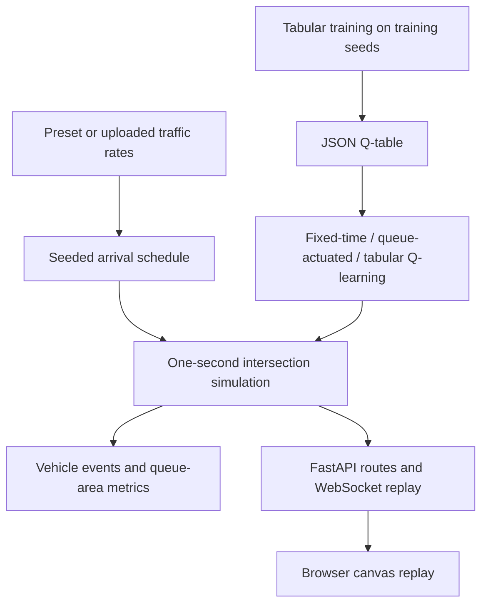

# TrafficAI

[](https://www.python.org/)
[](https://fastapi.tiangolo.com/)

TrafficAI is an intersection traffic simulator and reinforcement learning benchmark. Its command-line evaluator compares fixed-time, queue-actuated, and tabular Q-learning controllers on shared seeded arrivals. The browser interface streams and visualizes matched controller executions.

## Architecture



## Features

- Evaluates fixed-time, queue-actuated, and Q-learning controllers on identical seeded arrivals.
- Supports standard 4-way intersections and custom topologies such as 3-way T-junctions.
- Discretized Q-learning agent with discounted horizon initialization and switch-penalty awareness.
- Context-aware rule layer preventing wasteful switches on empty queues and enforcing safety limits.
- Reports experienced wait, completed wait, average queue length, throughput, and signal switches.
- Streams vehicle and signal events to a browser interface via WebSocket.
- Accepts preset traffic profiles or uploaded CSV rate schedules.

## Results

Evaluation across 20 paired seeds (seeds 42 through 61, 300 seconds each):

| Scenario | Controller | Experienced wait (s) | Queue length | Departed |
|---|---|---:|---:|---:|
| Balanced | Fixed-time | 11.27 | 2.69 | 69.3 |
| Balanced | Queue-actuated | 12.74 | 3.01 | 68.5 |
| Balanced | Tabular Q-learning | 10.73 | 2.56 | 69.5 |
| Spike | Fixed-time | 11.27 | 2.69 | 69.3 |
| Spike | Queue-actuated | 12.74 | 3.01 | 68.5 |
| Spike | Tabular Q-learning | 10.73 | 2.56 | 69.5 |
| T-junction | Fixed-time | 12.75 | 3.06 | 73.1 |
| T-junction | Queue-actuated | 13.20 | 3.16 | 73.1 |
| T-junction | Tabular Q-learning | 12.45 | 2.99 | 73.3 |
| NS Heavy | Fixed-time | 21.96 | 7.94 | 115.3 |
| NS Heavy | Queue-actuated | 9.57 | 3.42 | 116.5 |
| NS Heavy | Tabular Q-learning | 11.77 | 4.22 | 116.1 |

Tabular Q-learning achieves the lowest experienced wait on balanced, spike, and T-junction scenarios while significantly improving over fixed timing on heavy directional skew.

## Quick Start

### Local web app

```powershell
py -m venv .venv
.\.venv\Scripts\Activate.ps1
python -m pip install --upgrade pip
python -m pip install -r requirements-web.txt
python backend/main.py
```

Open `http://localhost:8000/`.

### Train and evaluate

To train a policy and run evaluation:

```powershell
python enhanced_train.py --agent_type tabular --episodes 60 --episode_length 1800 --scenarios balanced morning_peak evening_peak ns_skew heavy spike t_junction --policy_output models/tabular_policy.json
python evaluation.py --agent models/tabular_policy.json --episode_length 300 --runs 20 --scenarios balanced heavy ns_heavy spike t_junction
```

To run the automated experiment pipeline:

```powershell
python run_enhanced_experiment.py --episodes 50 --episode_length 900
```

## Technical Design

### Simulation and measurements

The simulation advances in one-second steps. Scheduled arrivals join the shortest lane of their approach. Vehicles on green approaches leave according to a saturation flow of 0.5 vehicles per second per lane after a two-second start-up delay. Green, yellow, and all-red clearance intervals are maintained by the traffic light controller.

Experienced wait is total accumulated queue seconds divided by total arrivals. Completed wait averages only vehicles that departed. Average queue length is accumulated queue seconds divided by elapsed simulation time.

### Controllers and rules

The fixed-time baseline cycles signals on a fixed 15-second timer. The queue-actuated controller monitors real-time queues and switches when opposing demand exceeds active demand by a configured threshold. The Q-learning controller maps discretized queue bins, active phase, and time in phase to actions, with safety constraints and starvation limits validated by `SophisticatedRuleLayer`.

## Tests

Run the test suite with pytest:

```powershell
python -m pytest tests -v
```

The suite includes 27 tests covering simulation dynamics, signal clearance, T-junction topology, queue actuation, Q-learning updates, rule validation, CSV ingestion, and paired evaluation metrics.

## License

MIT License

Copyright (c) [2026] [Schrodi-Ø-Ao]

Permission is hereby granted, free of charge, to any person obtaining a copy
of this software and associated documentation files (the "Software"), to deal
in the Software without restriction, including without limitation the rights
to use, copy, modify, merge, publish, distribute, sublicense, and/or sell
copies of the Software, and to permit persons to whom the Software is
furnished to do so, subject to the following conditions:

The above copyright notice and this permission notice shall be included in all
copies or substantial portions of the Software.

THE SOFTWARE IS PROVIDED "AS IS", WITHOUT WARRANTY OF ANY KIND, EXPRESS OR
IMPLIED, INCLUDING BUT NOT LIMITED TO THE WARRANTIES OF MERCHANTABILITY,
FITNESS FOR A PARTICULAR PURPOSE AND NONINFRINGEMENT. IN NO EVENT SHALL THE
AUTHORS OR COPYRIGHT HOLDERS BE LIABLE FOR ANY CLAIM, DAMAGES OR OTHER
LIABILITY, WHETHER IN AN ACTION OF CONTRACT, TORT OR OTHERWISE, ARISING FROM,
OUT OF OR IN CONNECTION WITH THE SOFTWARE OR THE USE OR OTHER DEALINGS IN THE
SOFTWARE.
